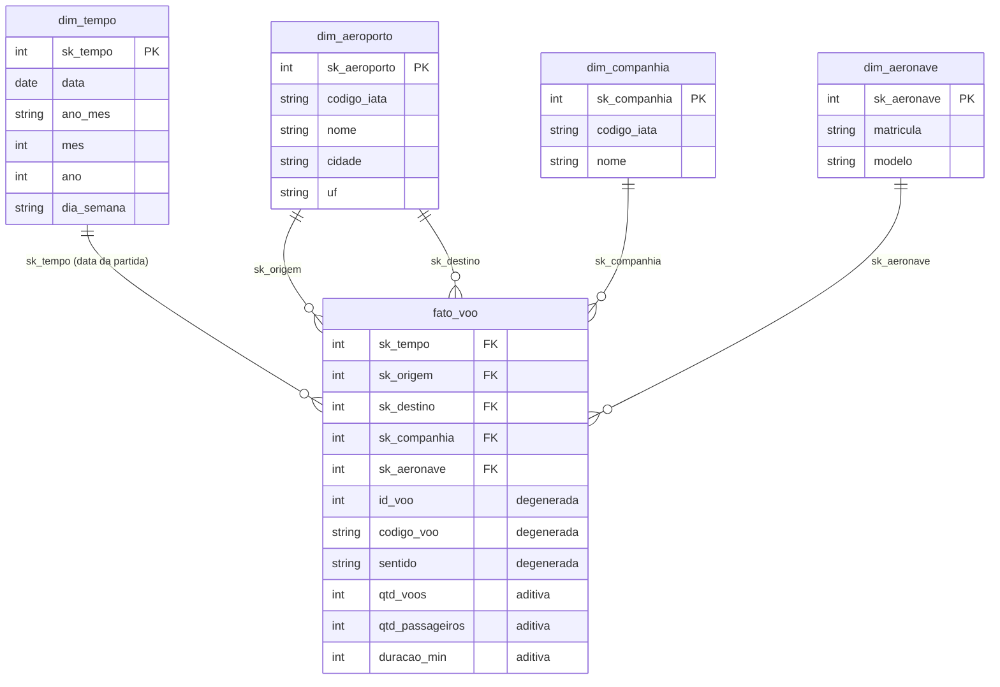

# Prática: Painéis do Aeroporto

**Projeto de origem (OLTP):** sistema de voos em PHP (`aula 25/aeroporto`), banco `aeroporto`.
Tabelas usadas pelo código: `VOO`, `AERONAVE`, `PASSAGEIRO_VOO` e `usuarios`. O `usuarios` só serve para o login e não entra nos painéis.

| Tabela OLTP | Campos usados |
|---|---|
| `VOO` | id_voo, codigo_voo, origem, destino, data_hora_partida, data_hora_chegada, id_aeronave |
| `AERONAVE` | id_aeronave, modelo, matricula |
| `PASSAGEIRO_VOO` | id_passageiro, id_voo (campos supostos; ver lacuna L4) |

O SQL completo do modelo, do ETL e das cinco consultas está em `paineis_aeroporto.sql`. Ele foi testado em MySQL 8.0 com dados de exemplo.

---

## 1. Modelo estrela

### Grão

**Uma linha da fato representa um voo** (um registro da tabela `VOO`).

### Medidas (tabela `fato_voo`)

| Medida | Tipo | Como é calculada |
|---|---|---|
| `qtd_voos` | Aditiva | Sempre 1 por linha; `SUM` dá o número de voos |
| `qtd_passageiros` | Aditiva | `COUNT(DISTINCT id_passageiro)` do voo em `PASSAGEIRO_VOO`, calculado no ETL |
| `duracao_min` | Aditiva | Chegada − partida, em minutos; a soma dá o tempo voado |
| Duração média | Não aditiva | Calculada na consulta: `SUM(duracao_min) / SUM(qtd_voos)` (não se soma média) |
| Participação % | Não aditiva | Voos da companhia ÷ total de voos |

Não há medida semiaditiva neste modelo, porque todas as medidas são de eventos (voos). Uma semiaditiva apareceria num fato de foto periódica, como "aeronaves na frota no fim do mês", que não pode ser somada ao longo do tempo.

### Dimensões

| Dimensão | Atributos principais |
|---|---|
| `dim_tempo` | sk_tempo (AAAAMMDD), data, dia, mes, nome_mes, **ano_mes**, trimestre, ano, dia_semana, fim_de_semana |
| `dim_aeroporto` (papel duplo: **origem** e **destino**) | sk_aeroporto, codigo_iata, nome, cidade, uf |
| `dim_companhia` | sk_companhia, codigo_iata, nome |
| `dim_aeronave` | sk_aeronave, id_aeronave, matricula, modelo |
| Degeneradas (na fato) | id_voo, codigo_voo, sentido (PARTIDA / CHEGADA em relação ao aeroporto sede) |

### Desenho da estrela



O mesmo desenho, em texto (para copiar à mão):

```
                     ┌──────────────┐
                     │  dim_tempo   │
                     └──────┬───────┘
                            │
┌────────────────┐   ┌──────┴────────────┐   ┌────────────────┐
│ dim_aeroporto  │───│     fato_voo      │───│ dim_companhia  │
│   (origem)     │   │ qtd_voos          │   └────────────────┘
└────────────────┘   │ qtd_passageiros   │
┌────────────────┐   │ duracao_min       │   ┌────────────────┐
│ dim_aeroporto  │───│ id_voo, codigo,   │───│  dim_aeronave  │
│   (destino)    │   │ sentido           │   └────────────────┘
└────────────────┘   └───────────────────┘
```

### Uma única tabela fato atende aos cinco painéis?

**Sim.** Os cinco painéis perguntam sobre voos: quantos, para onde, de qual companhia, com qual aeronave, quando e com quantas pessoas. Tudo isso cabe no grão "um voo". Os passageiros entram já somados por voo (`qtd_passageiros`), então o painel 2 não precisa de outra fato e não há risco de contar o mesmo voo várias vezes.

Uma segunda fato, com grão "um passageiro em um voo", só seria necessária para perguntas sobre os passageiros em si, como passageiros *distintos* no mês (a mesma pessoa em dois voos conta duas vezes no nosso painel 2) ou perfil por idade e sexo.

---

## 2. Fichas dos painéis

### Painel 1 — Destinos mais frequentes

| Campo | Resposta |
|---|---|
| Pergunta de negócio | Para quais destinos saem mais voos do aeroporto? |
| Indicador (medida) | `SUM(qtd_voos)` |
| Dimensões usadas | dim_aeroporto (papel destino); sentido (degenerada) |
| Filtros do painel | Período (ano/mês), companhia |
| Gráfico sugerido | Barras horizontais (Top 10) |
| Operação OLAP | (X) slice — só voos de partida |

### Painel 2 — Número de passageiros por mês

| Campo | Resposta |
|---|---|
| Pergunta de negócio | Como o movimento de passageiros evolui mês a mês? |
| Indicador (medida) | `SUM(qtd_passageiros)` |
| Dimensões usadas | dim_tempo (ano_mes) |
| Filtros do painel | Ano, sentido (partida/chegada) |
| Gráfico sugerido | Linha (eixo X = mês) |
| Operação OLAP | (X) roll up — de dia para mês (drill down volta para o dia) |

### Painel 3 — Número de voos

| Campo | Resposta |
|---|---|
| Pergunta de negócio | Quantos voos o aeroporto operou no período? |
| Indicador (medida) | `SUM(qtd_voos)` |
| Dimensões usadas | dim_tempo; sentido |
| Filtros do painel | Ano/mês, sentido |
| Gráfico sugerido | Cartão de KPI (número grande), com a variação em relação ao mês anterior |
| Operação OLAP | (X) dice — período + sentido |

### Painel 4 — Companhia aérea mais atuante

| Campo | Resposta |
|---|---|
| Pergunta de negócio | Qual companhia mais opera no aeroporto e qual a fatia de cada uma? |
| Indicador (medida) | `SUM(qtd_voos)` e participação % |
| Dimensões usadas | dim_companhia, dim_tempo |
| Filtros do painel | Ano/mês |
| Gráfico sugerido | Barras ordenadas com rótulo de % (ou rosca, se forem poucas companhias) |
| Operação OLAP | (X) slice — um ano; (X) pivot para ver companhia × mês |

### Painel 5 (livre) — Uso da frota por modelo de aeronave

| Campo | Resposta |
|---|---|
| Pergunta de negócio | Quais modelos de aeronave mais voam e quanto tempo ficam no ar? |
| Indicador (medida) | `SUM(qtd_voos)`, horas voadas (`SUM(duracao_min)/60`), duração média |
| Dimensões usadas | dim_aeronave (modelo → matrícula), dim_tempo |
| Filtros do painel | Ano/mês, companhia |
| Gráfico sugerido | Barras de horas voadas por modelo; tabela com a duração média |
| Operação OLAP | (X) drill down — de modelo para matrícula |

---

## 3. Estrutura das consultas

Todas partem de `fato_voo` e usam só as dimensões necessárias.

### Painel 1 — Destinos mais frequentes

```sql
SELECT   d.codigo_iata, d.cidade, SUM(f.qtd_voos) AS voos
FROM     fato_voo f
JOIN     dim_aeroporto d ON d.sk_aeroporto = f.sk_destino
WHERE    f.sentido = 'PARTIDA'
GROUP BY d.codigo_iata, d.cidade
ORDER BY voos DESC
LIMIT    10;
```
- **GROUP BY:** codigo_iata e cidade do destino
- **WHERE:** sentido = 'PARTIDA'
- **OLAP:** slice

### Painel 2 — Passageiros por mês

```sql
SELECT   t.ano_mes, SUM(f.qtd_passageiros) AS passageiros
FROM     fato_voo f
JOIN     dim_tempo t ON t.sk_tempo = f.sk_tempo
WHERE    t.ano = 2026
GROUP BY t.ano_mes
ORDER BY t.ano_mes;
```
- **GROUP BY:** ano_mes
- **WHERE:** ano = 2026
- **OLAP:** roll up (dia → mês)
- Por ser evolução, ordena pelo tempo e não usa LIMIT.

### Painel 3 — Número de voos

```sql
SELECT   SUM(f.qtd_voos) AS total_voos
FROM     fato_voo f
JOIN     dim_tempo t ON t.sk_tempo = f.sk_tempo
WHERE    t.ano = 2026
  AND    f.sentido IN ('PARTIDA', 'CHEGADA');
```
- **GROUP BY:** nenhum (o resultado é um número só)
- **WHERE:** ano e sentido
- **OLAP:** dice

### Painel 4 — Companhia mais atuante

```sql
SELECT   c.nome AS companhia,
         SUM(f.qtd_voos) AS voos,
         ROUND(100 * SUM(f.qtd_voos) / SUM(SUM(f.qtd_voos)) OVER (), 1) AS participacao_pct
FROM     fato_voo f
JOIN     dim_companhia c ON c.sk_companhia = f.sk_companhia
JOIN     dim_tempo t     ON t.sk_tempo     = f.sk_tempo
WHERE    t.ano = 2026
GROUP BY c.nome
ORDER BY voos DESC
LIMIT    5;
```
- **GROUP BY:** nome da companhia
- **WHERE:** ano = 2026
- **OLAP:** slice
- `SUM(...) OVER ()` é o total geral, usado no cálculo da participação.

### Painel 5 — Uso da frota

```sql
SELECT   a.modelo,
         SUM(f.qtd_voos)                                AS voos,
         ROUND(SUM(f.duracao_min) / 60, 1)              AS horas_voadas,
         ROUND(SUM(f.duracao_min) / SUM(f.qtd_voos), 0) AS duracao_media_min
FROM     fato_voo f
JOIN     dim_aeronave a ON a.sk_aeronave = f.sk_aeronave
JOIN     dim_tempo t    ON t.sk_tempo    = f.sk_tempo
WHERE    t.ano = 2026
GROUP BY a.modelo
ORDER BY horas_voadas DESC
LIMIT    10;
```
- **GROUP BY:** modelo; no drill down, `modelo, matricula`
- **WHERE:** ano = 2026
- **OLAP:** drill down

---

## 4. ETL e wireframe

### ETL

- **Extract:** lê `VOO`, `AERONAVE` e `PASSAGEIRO_VOO` do banco `aeroporto`. Nomes de aeroportos e companhias vêm de tabelas de apoio, porque o OLTP não os tem.
- **Transform:** padroniza os códigos (`UPPER`/`TRIM`), tira a companhia das 2 letras do `codigo_voo`, calcula a duração em minutos, define o sentido em relação ao aeroporto sede, conta os passageiros distintos por voo e troca as chaves naturais por surrogate keys.
- **Load:** carrega primeiro as dimensões (`dim_tempo`, `dim_aeroporto`, `dim_companhia`, `dim_aeronave`) e por último a `fato_voo`.

### Wireframe (Painel de Operação — base para o desenho à mão)

```
┌──────────────────────────────────────────────────────────────────────┐
│  PAINEL DE OPERAÇÃO — AEROPORTO DE BRASÍLIA (BSB)                     │
│  Filtros:  [Ano ▼ 2026]  [Mês ▼ Todos]  [Companhia ▼ Todas]  [Sentido ▼]│
├──────────────────┬──────────────────┬────────────────────────────────┤
│   VOOS NO ANO    │  PASSAGEIROS     │  COMPANHIA LÍDER               │
│     1.248        │    48.900        │  LATAM — 50%                   │
│   ▲ 6% vs 2025   │   ▲ 3% vs 2025   │                                │
├──────────────────┴──────────────────┴────────────────────────────────┤
│  Passageiros por mês (linha)                                          │
│   5k ┤        ╭─╮      ╭──╮                                           │
│   4k ┤ ╭──╮╭──╯ ╰──╮╭──╯  ╰──╮                                        │
│   3k ┼─╯  ╰╯       ╰╯        ╰─                                       │
│      Jan Fev Mar Abr Mai Jun Jul Ago Set Out Nov Dez                  │
├───────────────────────────────────┬──────────────────────────────────┤
│  Top 10 destinos (barras)         │  Participação por companhia       │
│  GRU  ████████████████  85        │  LATAM  ██████████  50%           │
│  GIG  ████████          43        │  Azul   █████       25%           │
│  SSA  ████████          43        │  Outras █████       25%           │
│  CNF  ████████          43        │                                   │
└───────────────────────────────────┴──────────────────────────────────┘
```

Indicador principal: **total de voos no período** (cartão à esquerda). Os filtros do topo valem para todos os gráficos. Os números do desenho são ilustrativos.

---

## 5. Lacunas do modelo OLTP

| # | Lacuna | Impacto nos painéis | Solução no modelo |
|---|---|---|---|
| L1 | Não há registro de qual é o aeroporto "sede" do sistema | Não dá para separar partidas de chegadas | Parâmetro `@aeroporto_sede` no ETL (ex.: 'BSB') |
| L2 | Não existe tabela de aeroportos: origem e destino são só códigos de 3 letras | Painel 1 mostraria só "GRU", sem cidade | Tabela de apoio `apoio_aeroporto` no ETL |
| L3 | Não existe tabela de companhias aéreas | Painel 4 não teria de onde tirar a companhia | Derivar das 2 primeiras letras do `codigo_voo`. A validação do projeto exige 2 letras, o que recusa códigos como 'G3' (GOL) |
| L4 | Não há script do banco no repositório; `PASSAGEIRO_VOO` só aparece num comentário do código | Colunas supostas: `id_passageiro`, `id_voo` | Confirmar os nomes no banco antes de rodar o ETL |
| L5 | `AERONAVE` não tem capacidade de assentos | Não dá para calcular taxa de ocupação | Incluir `capacidade` em AERONAVE |
| L6 | `VOO` não tem status (cancelado, atrasado) nem horários reais | Voos cancelados entram na contagem; não há painel de pontualidade | Incluir `status` e horários reais em VOO |
| L7 | A exclusão de voo é física (`DELETE`) | Voos excluídos somem do histórico na próxima carga completa | Exclusão lógica (`ativo = 0`) ou carga incremental |
| L8 | Só se cadastra voo com partida no futuro | Os painéis mostram voos programados, não realizados | Registrar a realização (ver L6) |

---

## Checklist

- [x] O grão da fato está escrito em uma frase: *uma linha = um voo*.
- [x] A dimensão tempo permite ver o painel por mês (`ano_mes`, `mes`, `ano`).
- [x] Toda consulta parte da fato e usa só as dimensões necessárias.
- [x] Todo atributo do SELECT sem agregação está no GROUP BY.
- [x] Rankings (painéis 1, 4 e 5) usam `ORDER BY ... DESC` e `LIMIT`.
- [x] Sem duplicidade: o grão é o voo (`id_voo` é a PK da fato), `qtd_voos` vale 1 por linha e os passageiros são somados por voo no ETL com `COUNT(DISTINCT)`, sem juntar `PASSAGEIRO_VOO` na consulta. Teste: 600 voos e 3.000 passageiros no OLTP de exemplo, os mesmos 600 e 3.000 na fato.
- [x] O ETL carrega as dimensões antes da fato.
